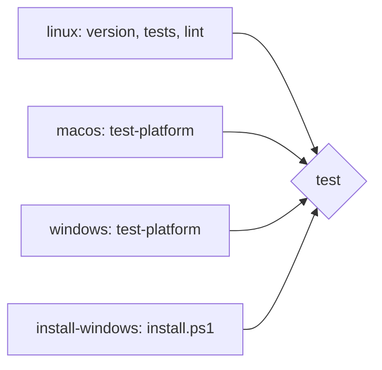

# workflows

| file | runs |
| --- | --- |
| [`test.yml`](./test.yml) | every push to main and every PR: Linux in full, then macOS and Windows, and `install.ps1` from the latest release on Windows |
| [`test-platform.yml`](./test-platform.yml) | Rust tests and clippy on one platform; called by `test.yml` |
| [`bench.yml`](./bench.yml) | when Rust, Lua, or Cargo files change: on each merge to main and daily, committing a result to `benches/results/`; on PRs ready for review, the PR benched once, compared with main's last result in a comment, and failing on a regression; required by main's ruleset |
| [`release.yml`](./release.yml) | a GitHub release for every push to main: stable when Cargo.toml bumps to X.Y.Z, a prerelease otherwise |

- `test` is required per ruleset, so `test` requires all platform-specific workflows to pass
- Lua, license, and version checks never vary, so they run only on Linux.
- `mise` defines CI and manual checks through [`mise-tasks`](../../mise-tasks).

## workflow settings

| variable | why |
| --- | --- |
| `MISE_JOBS: 1`, `MISE_TASK_OUTPUT: interleave` | mise prefixes parallel output with the task's label, and Actions reads `::error::` only at the start of a line |
| `MISE_WINDOWS_DEFAULT_*_SHELL_ARGS` | the tasks are bash, and mise runs them with cmd on Windows. mise ignores these in a project's `mise.toml`, so a repository cannot choose a user's shell |
| `MISE_TASK_RUN_AUTO_INSTALL: false` | `mise run` would install every tool in `mise.toml`, the Linux-only lint tools included; macOS hit GitHub's API rate limit doing so |
| `GITHUB_TOKEN` | lifts the rate limit for any API call mise still makes |
