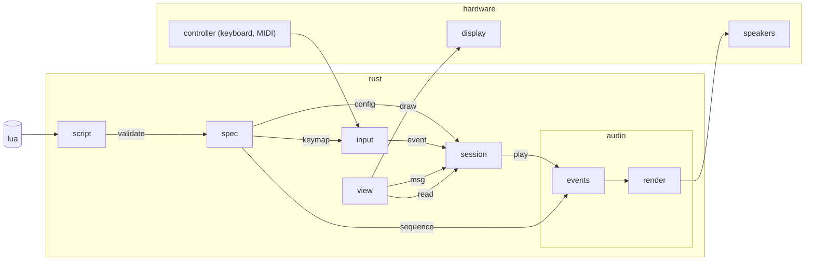

# synth
[](https://github.com/turkosaurus/synth/actions/workflows/test.yml)


_Lua-defined, Rust-driven synthesizer and sequencer_

## about

A real-time Rust digital instrument and audio workstation configured and driven by Lua functions and tables.
- Design principles: [`RULES.md`](RULES.md)
- Development process: [`CONTRIBUTING.md`](CONTRIBUTING.md)

## install

### Linux[^requires]/MacOS

[`install.sh`](./install.sh) downloads and verifies the latest stable release, installing it to `$XDG_BIN_HOME`, or `~/.local/bin`[^manager].

```sh
curl -fsSL https://raw.githubusercontent.com/turkosaurus/synth/main/install.sh | bash
```

[^manager]: `update` and `uninstall` act on the binary being run; defer to package manager if installed through one.

[^requires]: requires `GLIBC_2.34+`


## run

### tui
```sh
synth tui
```

### components



details: [`lua`](./lua), [`script`](./src/script), [`spec`](./src/spec), [`input`](./src/input), [`session`](./src/session.rs), [`audio`](./src/audio), [`view`](./src/view), or [`src`](./src)

## contributing
- see [`CONTRIBUTING.md`](CONTRIBUTING.md)

### roadmap
- [v1.0 issues](https://github.com/turkosaurus/synth/milestone/1)
- [kanban](https://github.com/users/turkosaurus/projects/4/views/2)
