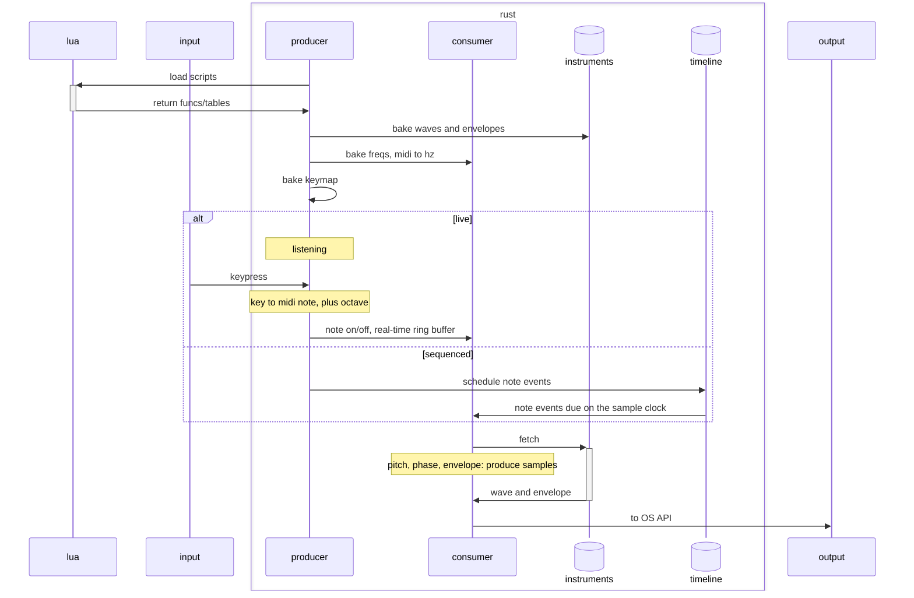

# synth
[](https://github.com/turkosaurus/synth/actions/workflows/test.yml)


_Lua defined, Rust synthesizer and sequencer_

## requirements

### linux
```sh
sudo apt install libasound2-dev pkg-config build-essential
```

## architecture 

Except where necessary to preserve a non-blocking, non-allocating audio pipeline, care is taken to implement [the ELM architecture](https://guide.elm-lang.org/architecture/), separating data, mutation, and presentation.

That exception is held by the module layout rather than by discipline, and `mise run test` enforces it: `mlua` may appear only under [`script/`](./src/script/), and `cpal` only in [`device.rs`](./src/audio/device.rs). [`render.rs`](./src/audio/render.rs) is therefore exactly what the audio callback executes, with no language runtime and no device within reach.

Goals:
- fast: bad fidelity sounds cool, bad timing sounds *wrong*
- extendable: anything not required to support speed should be extendable with Lua 

Views are assembled from data, and presentation layers never do additional work.

### diagram



## backend

### lua

- oscillator/generator: mathematical slopes and waveforms defined by Lua functions
- envelope: same slopes may define an ADSR amp envelope 
- sequencer: composed instruments may be sequenced and chained 

### rust

#### baking

Lua waveforms are built as a single oscillation across `TABLE_SIZE` samples, expected to be sub-sonic, such that one can produce a particular pitch by selecting 1-in-10 samples, then produce a pitch one octave higher by selecting 1-in-20 samples. Phase is usually fractional, so playback interpolates between neighbouring entries.

Lua states the two shapes differently. A waveform is a function of phase, so Rust calls it once per point across the table. An envelope segment is a function of its endpoints and length, so Rust calls it once and Lua returns the whole run.

2048 points means every note above 23.4 Hz advances at least one entry per output sample, so no playable pitch stretches the shape; at 8 KB it also stays in L1.

An instrument reaches the audio backend as two things: one cycle of waveform, and an amplitude envelope that scales it. The waveform loops at pitch for as long as the note sounds, in every stage.

The envelope is baked in four parts:
- attack (fixed-length)
- decay (fixed-length)
- sustain (a level, variable duration)[^sustain_looping]
- release (fixed-length)

[^sustain_looping]: Sustain is a level, not a buffer. The waveform keeps looping while held, or for a duration of fixed length, or until interrupted; the envelope just stops moving.

Baking is sample-rate dependent, and comes from the system, so must be handled by the Rust side.

#### triggering

Listeners detect MIDI codes, whether from character keyboard translation in a terminal, or from a USB device, and the resulting note events are handed to a real-time ring buffer.

#### dispatching

Non-blocking, pure Rust audio pipeline that consumes a real-time ring buffer.

## frontend

### terminal

Character keyboard and TUI can provide the most minimal input and output, respectively. 
