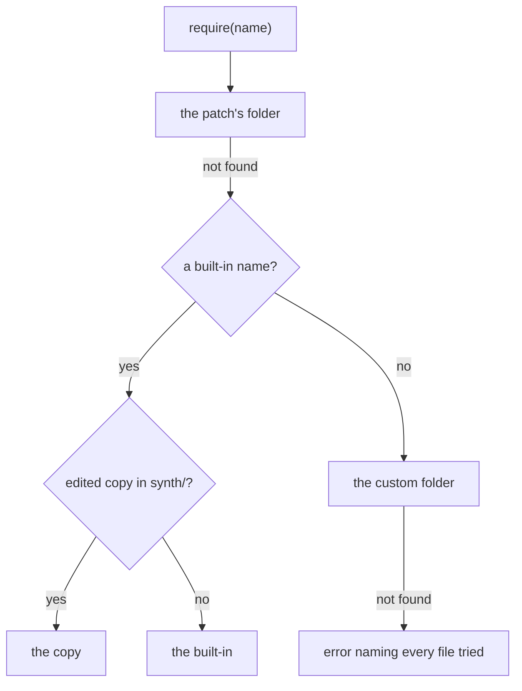
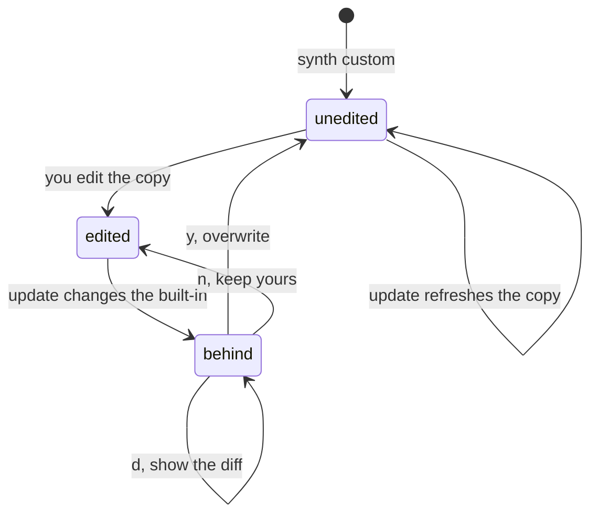

# custom

Bootstrap for the custom folder. `synth custom` creates the directory with a subdirectory per patch kind, and writes each kind's `example.lua`, if empty (populated directories are skipped to persist user customizations).

| folder | holds |
| --- | --- |
| [`instruments/`](./instruments) | waveform and envelope |
| [`effects/`](./effects) | filters for the summed output |
| [`keyboards/`](./keyboards) | layout and control keys |
| [`tunings/`](./tunings) | MIDI note to Hz |
| [`patterns/`](./patterns) | steps for a sequence |

`custom_dir` in `config.lua` (`synth config` opens it) defaults to `$XDG_DATA_HOME/synth/custom` (or `%APPDATA%\synth\custom`) when unset or `""`. `synth custom --path` prints it.

## require

`a.b` is `a/b.lua` or `a/b/init.lua`, so `require("instruments.bass")` finds `instruments/bass.lua`. Nothing resolves from the shell's working directory or the system's Lua folders.

Every name, `synth` and `synth.*` included, is looked for in the patch's folder first, so a `synth/wave.lua` beside a patch replaces the built-in for that patch.

## built-in copies

`synth custom` also writes a copy of each built-in module into `synth/`: `synth.wave` is `synth/wave.lua`, and `synth` is `synth/init.lua`. Edit a copy and it loads in place of the built-in.

`synth/.base.sha256` records the built-in each copy was written from, in `sha256sum`'s format, so `sha256sum -c .base.sha256` in `synth/` lists the copies you edited. A copy still matching its base is not used, so a newer built-in reaches you. `synth doctor` shows where each one stands.

- `synth update` runs `synth custom --sync` once copies exist, which refreshes unedited copies and asks about each copy that is behind.
- The question is asked only at a terminal. Elsewhere the copies that are behind are named and kept.
- Keeping yours records the new built-in as its base, so it is not asked about again until the built-in changes again.
- A copy with no record in `.base.sha256` counts as edited and is kept.

## guides

`synth custom` also writes this `README.md`, an `AGENTS.md` for coding agents, and a `.luarc.json` that sets up lua-language-server for LuaJIT, to the folder's root. They follow the same rules as the built-in copies, with their own `.base.sha256` beside them.
