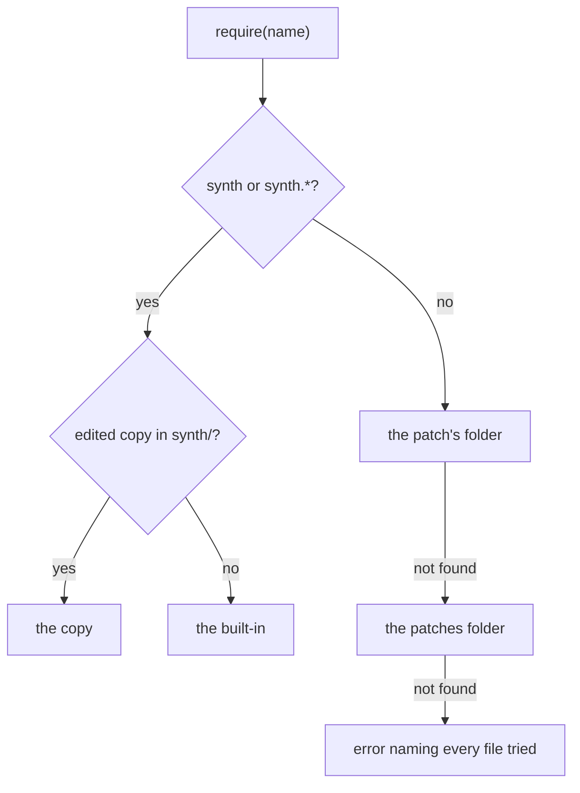
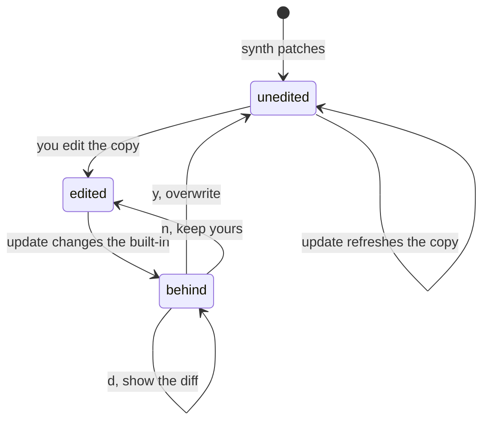

# patches

Bootstrap for the patches folder. `synth patches` creates the directory with a subdirectory per patch kind, and writes each kind's `example.lua`, if empty (populated directories are skipped to persist user customizations).

| folder | holds |
| --- | --- |
| [`instrument/`](./instrument) | waveform and envelope |
| [`effect/`](./effect) | filters for the summed output |
| [`keyboard/`](./keyboard) | layout and control keys |
| [`tuning/`](./tuning) | MIDI note to Hz |
| [`pattern/`](./pattern) | steps for a sequence |

#TODO: fix this trainwreck of a sentence.
The folder is `patches` in `config.lua`. Left as `""`, it is `$XDG_DATA_HOME/synth/patches` (`~/.local/share/synth/patches`), or `%APPDATA%\synth\patches` on Windows. `synth patches --path` prints it.

## require

`a.b` is `a/b.lua` or `a/b/init.lua`, so `require("instrument.bass")` finds `instrument/bass.lua`. Nothing resolves from the shell's working directory or the system's Lua folders.

## built-in copies

`synth patches` also writes a copy of each built-in module into `synth/`: `synth.wave` is `synth/wave.lua`, and `synth` is `synth/init.lua`. Edit a copy and it loads in place of the built-in.

`synth/.base.sha256` records the built-in each copy was written from, in `sha256sum`'s format, so `sha256sum -c .base.sha256` in `synth/` lists the copies you edited. A copy still matching its base is not used, so a newer built-in reaches you. `synth doctor` shows where each one stands.

- `synth update` runs `synth patches --sync` once copies exist, which refreshes unedited copies and asks about each copy that is behind.
- The question is asked only at a terminal. Elsewhere the copies that are behind are named and kept.
- Keeping yours records the new built-in as its base, so it is not asked about again until the built-in changes again.
- A copy with no record in `.base.sha256` counts as edited and is kept.
