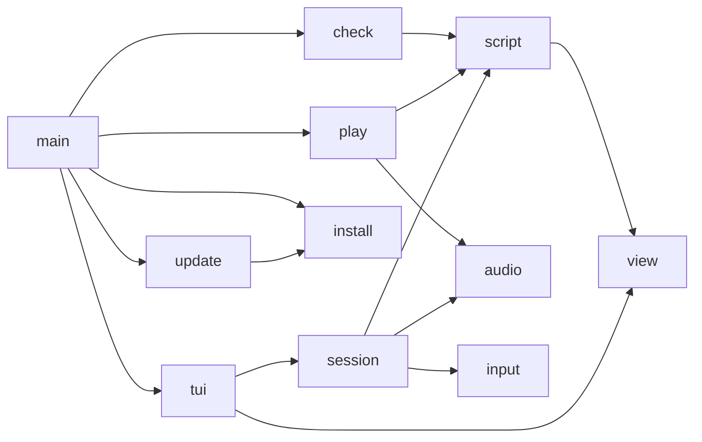

# src

| module | purpose |
| --- | --- |
| [`main.rs`](./main.rs) | CLI: parses a command and dispatches it |
| [`script`](./script) | Lua in, `spec` out |
| [`spec`](./spec) | plain data between `script` and `audio` |
| [`audio`](./audio) | the realtime path: render and device |
| [`input`](./input) | character keyboard to note events |
| [`session.rs`](./session.rs) | wires device, patch, and ring for a live view |
| [`view`](./view) | tui, reports, prompts |
| [`terminal.rs`](./terminal.rs) | raw mode and key release detection |
| [`install.rs`](./install.rs) | `install`, `uninstall` |
| [`update.rs`](./update.rs) | `update` from GitHub releases |
| [`release.rs`](./release.rs) | build identity for `--version` |

`mlua` stays in `script`, `cpal` in `audio/device.rs`, and `spec` names neither; [`test:separation`](../mise-tasks/test/separation) checks it.
