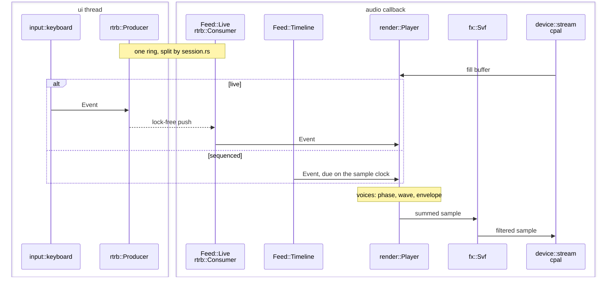

# audio

| file | purpose |
| --- | --- |
| [`render.rs`](./render.rs) | `Player`: what the callback runs; never allocates, locks, or blocks |
| [`device.rs`](./device.rs) | the only place `cpal` appears; opens and streams, and `Error` for why either failed |
| [`fx`](./fx) | per-sample processors, `core` only |

## terms

| term | type | definition |
| ---  | ---  | ---        |
| clip | | recorded audio; a clip loops, where a sequence repeats |
| fragment | | part of a clip, which can loop as an oscillator waveform or become a cycle of a wavetable |
| loop start | | where a looping clip plays again from |
| loop end | | where a looping clip turns back to its loop start |
| one-shot | | a clip that plays once through, without looping |
| overdub | | recording onto a clip as it loops, layered over what it holds |
| feedback | | a graph connection from a node back to itself |
| clipped | count | samples beyond full scale, each written clamped to it; `Snapshot`, the TUI, and `play`'s stats line |
