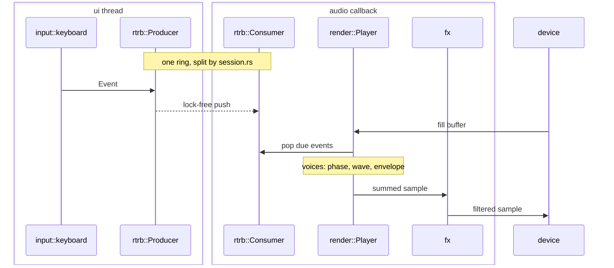

# audio

| file | purpose |
| --- | --- |
| [`render.rs`](./render.rs) | `Player`: what the callback runs; never allocates, locks, or blocks |
| [`device.rs`](./device.rs) | the only place `cpal` appears; opens and streams |
| [`fx`](./fx) | per-sample processors, `core` only |

A sequenced patch has no ring: `Player` reads events from its `Timeline` on the sample clock instead.
