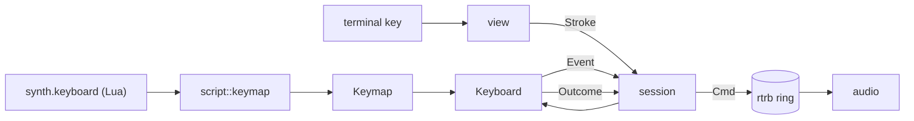

# input

Key presses to note events. A layout is Lua's, checked into a `Keymap` by [`script/keymap.rs`](../script/keymap.rs); this module reads keys against it, translated by the view from its own library, and hands each `Event` back to the session, which pushes it into the ring the audio callback reads.

| file | purpose |
| --- | --- |
| [`keyboard.rs`](./keyboard.rs) | `Keyboard`: key to `Event`, octave shift, control keys, gating |

## layouts

[`lua/keyboard.lua`](../../lua/keyboard.lua) ships `qwerty`, `qwertz`, `azerty`, `dvorak` and `colemak`. Each lines its rows up on the same physical keys, so one position plays the same note in every layout, and each brings its own octave and help keys so none of them takes a note key. A keyboard may replace those keys, as [`custom/keyboards/example.lua`](../../lua/custom/keyboards/example.lua) shows.

## gating

How a note ends depends on whether the terminal reports key release. `synth doctor` says which mode it found.

| mode | when | note ends |
| --- | --- | --- |
| `Held` | release reported: Windows, or a terminal with the kitty keyboard protocol | on release |
| `Fixed` | no release reported | after `gate` ms; a press within `autorepeat_threshold` ms of the key's last press is OS autorepeat and ignored, so a held key sounds once, then once more at the OS repeat delay |
