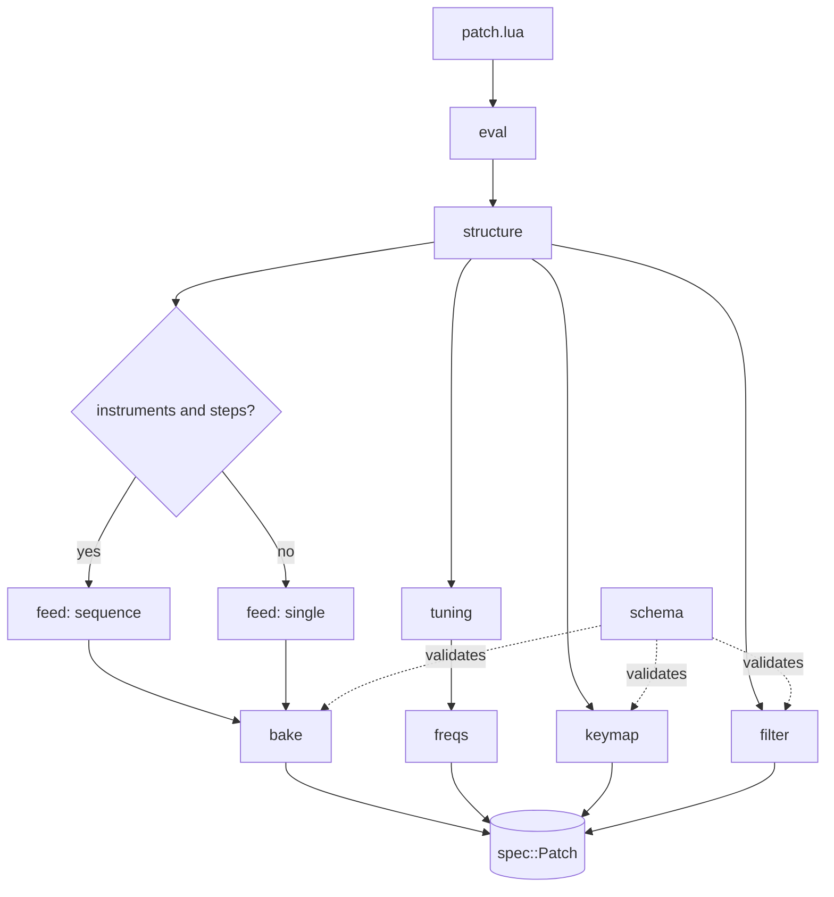

# script

The only place `mlua` appears. Loads a patch, checks it, and bakes it into [`spec`](../spec) data; Lua is dropped once the patch is returned.

| file | purpose |
| --- | --- |
| [`structure.rs`](./structure.rs) | walks constructor stamps; kinds, cycles, paths |
| [`schema.rs`](./schema.rs) | what values are valid, declared once |
| [`bake.rs`](./bake.rs) | instrument to wavetable and envelope |
| [`feed.rs`](./feed.rs) | single note or sequence to a timeline |
| [`keymap.rs`](./keymap.rs) | keyboard layout to keymap |
| [`filter.rs`](./filter.rs) | filter table to `Filter` and its report |
| [`config.rs`](./config.rs) | `config.lua`, read once at startup |
| [`builtins.rs`](./builtins.rs) | editable copies of the built-in modules |
| [`starters.rs`](./starters.rs) | one example patch per kind |

