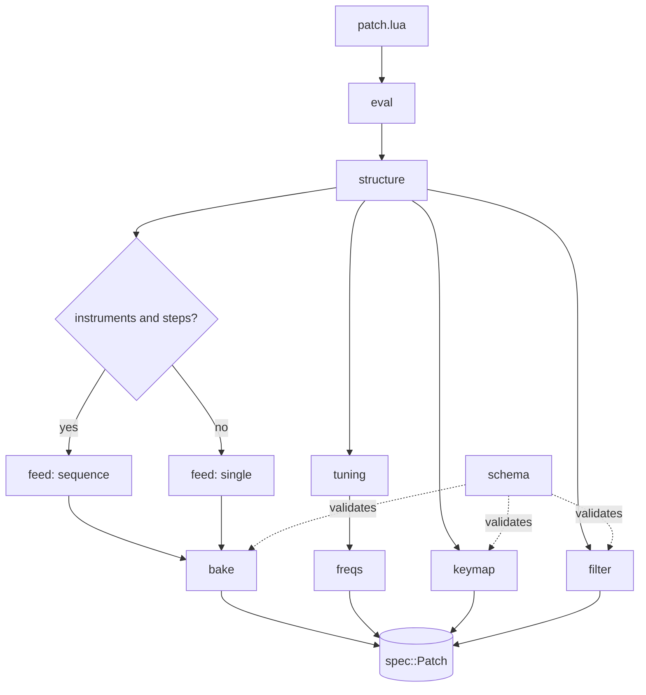

# script

The only place `mlua` appears. Loads a patch, checks it, and bakes it into [`spec`](../spec) data; Lua is dropped once the patch is returned.

| file | purpose |
| --- | --- |
| [`structure.rs`](./structure.rs) | walks constructor stamps; kinds, cycles, paths |
| [`schema.rs`](./schema.rs) | what values are valid, declared once |
| [`error.rs`](./error.rs) | `Error`: why a patch failed, by variant |
| [`bake.rs`](./bake.rs) | instrument to wavetable and envelope |
| [`feed.rs`](./feed.rs) | single note or sequence to a timeline |
| [`keymap.rs`](./keymap.rs) | keyboard layout to keymap |
| [`filter.rs`](./filter.rs) | filter table to `Filter` and its report |
| [`config.rs`](./config.rs) | `config.lua`, read once at startup |
| [`builtins.rs`](./builtins.rs) | editable copies of the built-in modules |
| [`starters.rs`](./starters.rs) | one example patch per kind |

## baking

An instrument reaches [`audio`](../audio) as one cycle of waveform and an amplitude envelope that scales it. The waveform loops at pitch for as long as the note sounds, in every stage.

### waveform

Rust calls the Lua waveform once per point across `TABLE_SIZE`, with phase from 0 to 1, and clamps each value to -1..1. Playback steps through the table at a rate set by pitch: twice the step is an octave up. Phase is usually fractional, so playback interpolates between neighbouring entries.

`TABLE_SIZE` is large enough that every note above `sample_rate / TABLE_SIZE` advances at least one entry per sample, so no playable pitch stretches the shape, and small enough to stay in L1.

### envelope

The envelope is baked in four parts:
- attack: 0 to 1
- decay: 1 to `sustain_level`
- sustain: a level, not a curve[^sustain]
- release: `sustain_level` to 0

[^sustain]: The waveform keeps looping while the note is held, or for a fixed duration, or until interrupted; the envelope just stops moving.

Rust calls each stage's curve once per point across `CURVE_POINTS + 1`, with t from 0 to 1, and clamps each value to 0..1. The points are the same whatever the stage's length: render stretches the curve over the stage's `ms` at the device's rate and scales it from the stage's start level to its end. Neither length nor sample rate is baked in.
