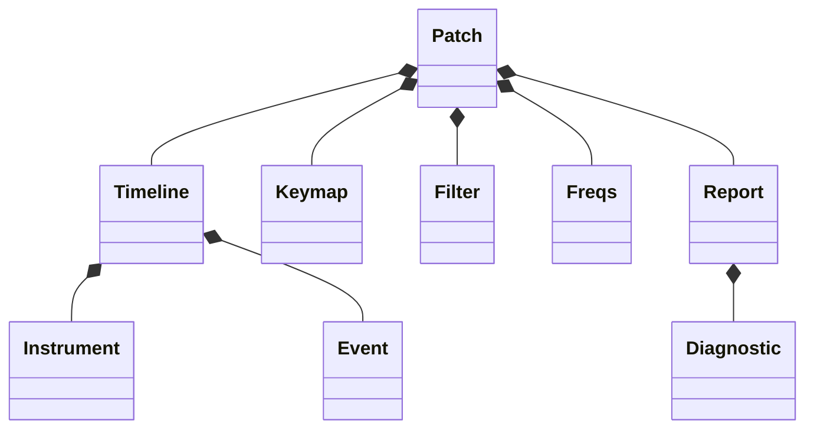

# spec

Plain data between [`script`](../script) and [`audio`](../audio). Names no other crate module, no `mlua`, no `cpal`.

| file | purpose |
| --- | --- |
| [`patch.rs`](./patch.rs) | `Patch`: everything a loaded file becomes |
| [`instrument.rs`](./instrument.rs) | `Instrument` and its checks, `Event`, `Timeline`, `Freqs` |
| [`keymap.rs`](./keymap.rs) | key to note |
| [`filter.rs`](./filter.rs) | filter request and its report |
| [`diagnostic.rs`](./diagnostic.rs) | warnings raised while baking |
| [`config.rs`](./config.rs) | machine settings |

