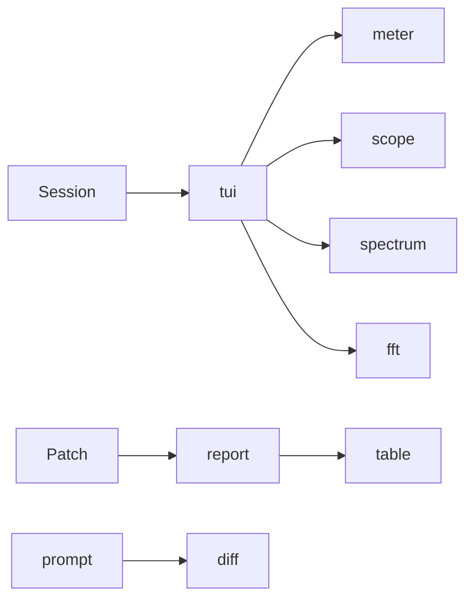

# view

Presentation only: draws data it is handed, does no work of its own.

| file | purpose |
| --- | --- |
| [`tui.rs`](./tui.rs) | drives a `Session` and draws it |
| [`meter.rs`](./meter.rs) | level meter ballistics |
| [`scope.rs`](./scope.rs) | oscilloscope trigger: the newest frames of a source, held still on a rising zero crossing |
| [`spectrum.rs`](./spectrum.rs) | spectrum widget: amplitude per bin as bars on a log frequency axis |
| [`fft.rs`](./fft.rs) | the spectrum's transform, with `realfft`, run by the TUI |
| [`report.rs`](./report.rs) | printed reports: patch, config, environment |
| [`table.rs`](./table.rs) | table formatting for reports |
| [`prompt.rs`](./prompt.rs) | overwrite question for edited built-ins |
| [`diff.rs`](./diff.rs) | line diff shown by the prompt |
| [`log.rs`](./log.rs) | a JSON log event as a coloured line for `synth log` |

